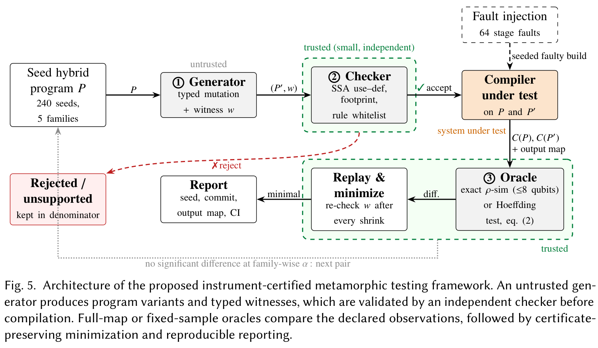

# Compositional Certificates for Metamorphic Testing of Quantum Compilers with Classical Control

This repository contains the source code accompanying the paper.

> - Compositional Certificates for Metamorphic Testing of Quantum Compilers with Classical Control.

## Overview

<p align="center">
  
</p>

InstrumentMT generates variants of quantum programs with classical control and attaches a semantic witness to each transformation. An independent checker reconstructs transformations from an allowlist and verifies their footprints, interfaces, and contexts. A density-matrix interpreter compares linear maps, and a fixed-sample statistical test compares declared classical outputs.

---

## Requirements

- Python >= 3.10
- NumPy, SymPy, and Z3 as package dependencies
- Pytest for correctness checks and Matplotlib for benchmark plots

See [requirements-validated.txt](requirements-validated.txt) for the versions used in the recorded validation.

---

## Usage

### 1. Install the Package

Run the commands from the repository root in Bash. In Windows PowerShell, activate the environment with `.\.venv\Scripts\Activate.ps1`.

```bash
python -m venv .venv
source .venv/bin/activate
python -m pip install -e ".[dev]"
```

### 2. Generate and Check a Program Variant

```bash
python -m instrumentmt examples/program.json --output witness.json
```

The command writes the source program, transformed variant, witness, and validation result to `witness.json`.

### 3. Run Correctness Checks

```bash
python -m pytest -q
```

See [docs/VALIDATION.md](docs/VALIDATION.md) for the recorded validation and its scope.

### 4. Run the Microbenchmark

```bash
python benchmarks/microbench.py
```

This regenerates `results/microbench.json` and the plots in `results/figures/`.

---

## Reference

- [Handling Non-Unitaries in Quantum Circuit Equivalence Checking](https://doi.org/10.1145/3489517.3530482)
- [MorphQ: Metamorphic Testing of the Qiskit Quantum Computing Platform](https://doi.org/10.1145/3561809)
- [A Survey on Metamorphic Testing](https://doi.org/10.1109/TSE.2016.2532875)
- [QDiff: Differential Testing of Quantum Software Stacks](https://doi.org/10.1109/ASE51524.2021.9678792)
